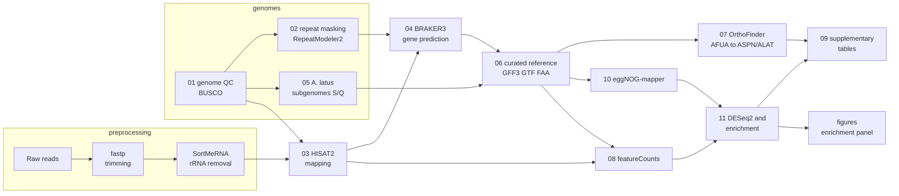

# AspHybrid

**Comparative genomics and transcriptomics of the allodiploid hybrid *Aspergillus latus* and its relatives *A. fumigatus* and *A. spinulosporus* during interaction with macrophages**

[](LICENSE)
[](https://doi.org/[ZENODO_DOI])

*Aspergillus latus* is a pathogenic allodiploid hybrid of section *Fumigati*:
its genome carries two parental subgenomes, one related to *A. spinulosporus*
(S) and one related to *A. quadrilineatus* (Q). AspHybrid is the complete,
reproducible workflow used in **[Article title]** ([Authors], [Journal],
[Year], doi:[DOI]) to annotate the hybrid and its relatives, assign every
*A. latus* gene to its parental subgenome, link genes across species, and
measure how each fungal strain changes its transcriptome when co-cultured with
macrophages.

It starts from genome assemblies and Illumina RNA-seq reads and produces
curated gene annotations, orthologue tables, count matrices, differential
expression, functional enrichment, publication figures and supplementary tables.

---

## Analyses

| Question | What the workflow produces | Steps |
|---|---|---|
| How complete are the genome assemblies? | Assembly statistics, BUSCO completeness, hybrid signature of *A. latus* (size ≈ sum of the parents, duplicated BUSCOs) | `01` |
| What are the genes of each species? | Curated GFF3 / GTF / protein / CDS files with stable locus_tags: official `AFUA_` for *A. fumigatus*, new `ASPN_` and `ALAT_` for *A. spinulosporus* and *A. latus* | `02` `04` `06` |
| Which parent does each *A. latus* gene come from? | Subgenome label (S, Q, ambiguous) for every gene, from 5-kb windows aligned to both parental genomes | `05` |
| Gene X in *A. fumigatus* is which gene in the other species? | AFUA-anchored orthologue table; both *A. latus* homeologs reported (relation 1:2) and tagged S/Q | `07` |
| Which genes are shared or species-specific? | Orthogroup-level sharing between the three species | `07` |
| How many reads map, and to which genes? | Sorted BAMs, mapping statistics, count / TPM / CPM matrices | `03` `08` |
| What does each gene do? | eggNOG-mapper annotation (GO, KEGG, COG, EC, CAZy, Pfam) and gene sets for enrichment | `10` |
| How does each strain respond to macrophages? | DESeq2 DEGs per strain (macrophage co-culture vs fungus alone), PCA, volcano plots, DEGs shared between strains, GO/KEGG/COG enrichment | `11` |

## Study design

Each strain was grown alone in DMEM (control) and co-cultured with murine
macrophages, with three biological replicates per condition. The fungal reads
of each library are analysed here; the host (macrophage) transcriptome is
analysed in a separate repository ([link]).

| Species | Ploidy | Genome and annotation | Strains (RNA-seq) | Libraries |
|---|---|---|---|---|
| *A. fumigatus* | haploid | Af293, official RefSeq annotation (GCF_000002655.1) | A1160 | 6 |
| *A. spinulosporus* | haploid | NRRL 2395, annotated here | 3, 5845 | 12 |
| *A. latus* | allodiploid (S + Q) | NRRL 200, annotated here | 1, 1710, 3622 | 18 |
| *A. quadrilineatus* | haploid | NRRL 201 (reference for subgenome Q only) | – | – |

## Workflow



## Repository structure

```
.
├── preprocessing/          read trimming (fastp) and rRNA removal (SortMeRNA)
├── pipeline/               genomics and transcriptomics, steps 01-11
│   ├── config.sh           the only file to edit (paths, threads, thresholds)
│   ├── rnaseq_samples.tsv  sample sheet
│   ├── 01_genome_qc.sh ... 11_differential_expression.sh
│   ├── lib/common.sh       shared functions and output paths
│   └── bin/                Python and R helpers called by the steps
├── figures/                publication figures from the curated enrichment panel
├── envs/                   conda / micromamba environment files
├── config/                 example sample sheet and design table
└── docs/                   installation, usage, configuration, outputs, methods, troubleshooting
```

## Requirements

- Linux workstation or server; developed with 28 threads and 123 GB RAM
  (eggNOG-mapper with `--dbmem` needs about 45 GB).
- About 500 GB–1 TB free disk for databases, BAM files and intermediate files.
- [micromamba](https://mamba.readthedocs.io) or conda, and Docker (BRAKER3 and
  RepeatModeler2/RepeatMasker run in containers pinned by digest).
- Local databases: BUSCO lineage `eurotiales_odb12.2`, OrthoDB v12 Fungi
  proteins, eggNOG 5. Gene Ontology, KEGG pathway names and the Af293 RefSeq
  annotation are downloaded once, automatically.

Full instructions: [docs/installation.md](docs/installation.md).

## Quick start

```bash
git clone https://github.com/MertzMatheus/AspHybrid.git
cd AspHybrid

# 1. environments and containers
micromamba create -f envs/annottools.yml   -p /path/to/envs/AnnotTools
micromamba create -f envs/detools.yml      -p /path/to/envs/DEtools
micromamba create -f envs/orthofinder.yml
micromamba create -f envs/preprocessing.yml
docker pull teambraker/braker3@sha256:5f8b3c508a9fe1bbc2e9a74dcc013eeed82f91dd5945adca7823514d9c8aecf8
docker pull dfam/tetools@sha256:7fe6afce694d0759b56d65b623a9d684269e8f82667f0f2eb79fca6a63c51189

# 2. configure paths, threads and databases
nano pipeline/config.sh
cp config/rnaseq_samples.example.tsv pipeline/rnaseq_samples.tsv   # then set the FASTQ paths

# 3. run one step at a time (each step checks its inputs and skips finished work)
cd pipeline
bash 01_genome_qc.sh A_latus
```

Full run order and expected results: [docs/usage.md](docs/usage.md).

## Pipeline steps

| Step | Script | What it does | Typical time |
|---|---|---|---|
| – | `preprocessing/01_quality.sh` | fastp trimming (Q20, min 30 nt, adapter auto-detection) | ~10 min / library |
| – | `preprocessing/02_remove_rRNA.sh` | SortMeRNA vs SILVA 16S/23S/18S/28S | ~20 min / library |
| 01 | `01_genome_qc.sh <sp>` | clean FASTA, assembly statistics, BUSCO | minutes |
| 02 | `02_repeat_masking.sh <sp>` | RepeatModeler2 (+LTR) and RepeatMasker soft-masking | 10–24 h |
| 03 | `03_map_rnaseq.sh <sp>` | HISAT2 to the species' own genome, QC table | 10–20 min / library |
| 04 | `04_gene_prediction.sh <sp>` | BRAKER3 ETP (RNA-seq + OrthoDB v12 Fungi proteins) | 6–24 h |
| 05 | `05_latus_subgenomes.sh` | S/Q assignment of *A. latus* in 5-kb windows | ~30 min |
| 06 | `06_reference_files.sh <sp>` | curation, locus_tags, GFF3/GTF/FASTA, validation, BUSCO | ~15 min |
| 07 | `07_orthology.sh` | OrthoFinder, AFUA-anchored orthologue tables, gene sharing | 30–90 min |
| 08 | `08_count_matrix.sh <sp>` | featureCounts, count / TPM / CPM matrices, RNA-seq QC | 10–30 min |
| 10 | `10_eggnog.sh <sp>` | eggNOG-mapper, gene annotation table, GO/KEGG/COG gene sets | 30–90 min |
| 11 | `11_differential_expression.sh <sp>` | DESeq2 per strain, enrichment, figures, Excel workbook | 5–15 min |
| 09 | `09_summary_tables.sh` | all supplementary tables in one workbook (run last) | 1 min |
| – | `figures/enrichment_figures.R` | dot plots and bar charts of the curated enrichment panel | 1 min |

`<sp>` is `A_fumigatus`, `A_spinulosporus` or `A_latus` (step 01 also takes `A_quadrilineatus`).

## Key design decisions

- **Official annotation for *A. fumigatus*.** The RefSeq Af293 annotation
  (locus_tags `AFUA_1G00100` …) is placed on the project genome after an MD5
  check that the sequences are identical, so results link directly to FungiDB,
  UniProt and the literature. A de novo BRAKER3 run on Af293 is kept as a
  benchmark of the annotation pipeline used for the other two species.
- **One annotation pipeline for *A. spinulosporus* and *A. latus*** (BRAKER3 ETP
  with RNA-seq and protein evidence), so gene models, orthology and expression
  are comparable.
- ***A. latus* is analysed as a hybrid.** Reads are mapped to the full hybrid
  genome (both subgenomes) and only uniquely placed reads (MAPQ ≥ 10) are
  counted, so reads that cannot be assigned to one homeolog are not counted.
  Every gene carries its subgenome (S/Q), and orthology reports both homeologs.
- **One DESeq2 model per species** (`~ strain_treatment`) with one contrast per
  strain (macrophage co-culture vs DMEM). DEG: adjusted p < 0.05 and
  absolute apeglm-shrunken log2 fold change ≥ 1.
- **Enrichment against the project's own annotation** (eggNOG GO terms
  propagated to ancestors, KEGG, COG): one-sided hypergeometric test with BH
  correction; universe = tested genes annotated in each collection.

Details and references: [docs/methods.md](docs/methods.md).

## Outputs

All results go to one folder (`OUT` in `config.sh`), one sub-folder per step,
plus `figures/` and `09_tables/Supplementary_Tables.xlsx`. Every file is
described in [docs/outputs.md](docs/outputs.md); the supplementary tables in
[docs/supplementary_tables.md](docs/supplementary_tables.md).

## Data availability

| Data | Location |
|---|---|
| Raw RNA-seq reads | NCBI SRA: [BioProject accession] |
| Gene annotations of *A. spinulosporus* NRRL 2395 and *A. latus* NRRL 200 | [Zenodo DOI / NCBI accession] |
| Count matrices, differential expression and enrichment results | Supplementary Data of the article; [Zenodo DOI] |
| Genome assemblies | *A. fumigatus* Af293 GCF_000002655.1; [accessions of the other assemblies] |

## Citation

If you use AspHybrid or its results, please cite the article and this repository:

> [Authors]. [Year]. [Article title]. *[Journal]*. doi:[DOI]
>
> [Authors]. [Year]. AspHybrid: comparative genomics and transcriptomics of the allodiploid hybrid *Aspergillus latus* (v1.0.0). Zenodo. doi:[ZENODO_DOI]

Citation metadata is in [CITATION.cff](CITATION.cff). Please also cite the
tools listed in [docs/methods.md](docs/methods.md#references).

## License

Code is released under the [MIT License](LICENSE). Third-party tools and
databases keep their own licenses.

## Contact

[Name], [Institution] – [email]. Questions and bug reports: please open a
[GitHub issue](../../issues).
